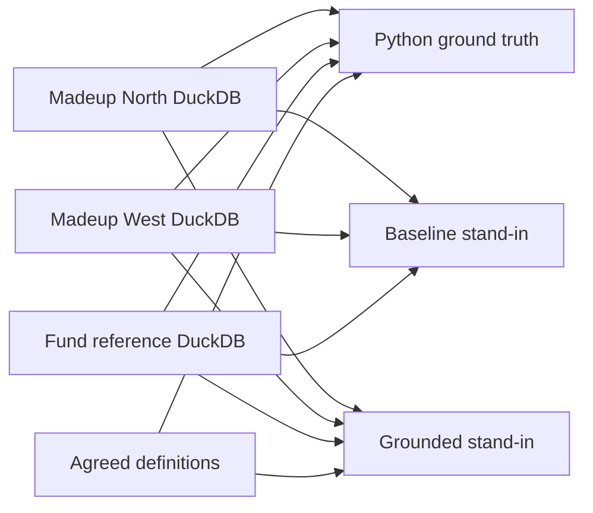

# pe-trusted-metrics-ontology

> **Prototype.** This is a demonstration built on synthetic data only. It is not production software and has not been validated for real use. See [Limitations](#limitations).

A fictional demonstration by Pedro Fernandes Barros. It asks whether a governed semantic layer, of the kind NVIDIA Auto Ontology builds, makes an agent's answers to fund KPI questions more accurate and easier to trace.

Madeup Holdco LP, Madeup North Logistics Ltd, and Madeup West Assemblies Inc are not real. The ledgers are synthetic. There is no client data in this repository.

Private-equity diligence and portfolio monitoring both ask for the same handful of numbers: Net Revenue, Adjusted EBITDA, EBITDA margin, and LTM. Portfolio companies rarely compute those words the same way. One books turnover gross of rebates and on a billed basis. Another books recognised net sales. One leaves cash rent and one-off costs inside EBITDA. Another reports after IFRS 16 and after a management add-back the fund has not accepted. An agent that writes SQL from column names can return a tidy consolidated figure that is still the wrong construct. A semantic layer is the place the fund's agreed meaning, the entity map, and the lineage live, so the SQL can be checked against that meaning and the answer can show where it came from.

Auto Ontology (https://github.com/NVIDIA/auto-ontology, Apache-2.0) is an open library that builds that layer from enterprise metadata and exposes it through MCP, a CLI, and an API. This repo does not fork it and does not vendor it. It uses the upstream DuckDB connector and catalog extractor where that code can run without a model, and it uses a labelled offline stand-in for the question-answering comparison.

## What the two companies do differently

Madeup North is a UK contract-logistics company. Its management pack is in sterling, snake_case, and a schema called `ledger`. Turnover on the pack is billed and gross of rebates, and it includes intercompany haulage billed to Madeup West. Reported EBITDA still deducts rebates, cash operating costs, property rent, and one-off costs. The pack is pre-IFRS 16. Proposed add-backs are not in that EBITDA number. Deferred income is ignored.

Madeup West is a US contract electronics assembler. Its pack is in dollars, PascalCase, and a schema called `ops`. Board revenue is gross billings. Adjusted EBITDA in the pack starts from recognised net sales, is already post-IFRS 16, adds back one-off charges, and adds back the full management add-back. Intercompany haulage sits in cash operating cost.

Madeup Holdco reports in sterling. Fund Net Revenue is third-party revenue recognised in the month, net of rebates, with intercompany revenue left out. Fund Adjusted EBITDA starts from that revenue, drops cash operating costs, excludes one-offs, does not deduct cash rent where the company still expenses it, does not add lease depreciation a second time where the company is already post-IFRS 16, and includes only the add-back stored on the fund policy table. LTM is twelve month-ends ending on the named month, inclusive. Margin is the sum of Adjusted EBITDA divided by the sum of Net Revenue over the same window, after translation. Each USD month is multiplied by that month's GBP-per-USD rate and rounded half away from zero to the cent before the months are summed. Both companies are wholly owned. There is no debt, no minority interest, and no purchase-price allocation.

The agreed definitions, entity map, and lineage are in `definitions/fund_definitions.yml`. The policy table is an input. How this fictional schedule was filled is disclosed there and in the recorded sentences below.

## Architecture



The oracle reads component columns and the policy table and computes the fund metrics in `decimal.Decimal`. It does not run the stand-in SQL.

The baseline stand-in is not a language model. It inspects the company fact table, scores column names by token overlap, and prefers names that look like a headline (`gross`, `reported`, `after`). It does not open the fund policy table. For a total across months it multiplies the summed USD amount by the single rate on the window end date. The definition guard is recorded against that SQL and does not block it.

The grounded stand-in is not a language model either. It copies the SQL expression from the agreed definition, translates USD month by month, and refuses to execute if the guard finds a column outside the lineage or a sum scaled by one rate. Both stand-ins are given a structured reading of the question. A model rerun should receive only the question text.

## What ran, and what did not

The real-model rerun has its own account of what ran, in the real-model results section. The rest of this section covers the earlier stand-in run. In that run, the Docker Compose stack, the model, term extraction, embeddings, and MCP were not run. KumoRFM stayed off, and nothing was uploaded. Catalog extraction from the upstream DuckDB connector did run. The accuracy comparison is the offline stand-in. The sentences in the recorded-figures section are copied from `results/` and are the source for every figure in this file.

## Setup

```bash
python -m venv .venv
.venv/bin/pip install -r requirements.txt
.venv/bin/python data/generate_portfolio.py
.venv/bin/python scripts/run_experiment.py
.venv/bin/python -m pytest
```

`data/generate_portfolio.py` writes three DuckDB files under `data/duckdb/`. Those files are generated, not committed. `scripts/run_experiment.py` regenerates them, scores both stand-ins, probes the Auto Ontology checkout, and rewrites `results/`.

If `/tmp/auto-ontology` is missing, the probe clones https://github.com/NVIDIA/auto-ontology into `.cache/auto-ontology`. Set `AUTO_ONTOLOGY_SRC` to point at another checkout. The probe does not modify that checkout.

## Run the full Auto Ontology stack

The real-model rerun below called the model directly and used Auto Ontology's catalog SQL parser. It did not start the full Auto Ontology stack. That would need Docker and Postgres, which were not available, so the steps below were not executed. They follow the upstream quickstart.

- Clone Auto Ontology and create its `.env` from `.env.example`.
- Set `DEFAULT_MODELS_API_KEY` to an NVIDIA API key, or point the model triplets (`REASONING`, `NON_REASONING`, `EMBED`, `RERANK`, falling back to `DEFAULT_MODELS`) at an OpenAI-compatible endpoint. Use a model that supports structured output, and keep the embedding model the same for ingestion and questions.
- Set the passwords the upstream quickstart requires. Do not set `KUMO_RFM_API_KEY`. Leaving it unset keeps the hosted predictive path off, so connected tables are not uploaded.
- Start Postgres, then the rest of the Compose stack, as the upstream README describes. Turn on semantic compilation in the UI if you want the generated ontology, then review it. Compilation calls the model.
- Attach the three DuckDB files with the `duckdb://` scheme. Do not load them into a hosted service.
- Ask the question text in `questions/questions.yml`. Do not send the `task` block. That block exists so the offline stand-in can be reproduced. A real agent has to read the sentence.
- Keep the returned SQL, rows, and provenance. Score them against `results/ground_truth.json` with the tolerances in the recorded sentences. Do not replace those ground-truth files with model output.

Ports, the commit that was read, and the import errors from this environment are in the recorded sentences.

## Real-model results (run on 23 Nov 2026)

This section is the real-model rerun. It is separate from the scripted stand-in results further down, which did not use a language model.

**Model.** `nvidia/nemotron-3-ultra-550b-a55b`, called through NVIDIA's OpenAI-compatible endpoint `https://integrate.api.nvidia.com/v1` at temperature 0, with three repeats per condition. The model id the API returned, the token use and the run notes are in `results/llm_scoreboard.json`. `mistralai/mistral-large-4-1t-a52b` was planned as a second model and was not run, because the account's throughput was too low to finish it in the time available. No Mistral numbers appear anywhere in this repo.

**What the model saw.** In both conditions, the model saw only the question sentence and the DuckDB schema (table and column names and types for the three fictional files). In the grounded condition, it also saw `definitions/fund_definitions.yml`, with the one note about the old baseline stand-in's FX method removed. The structured `task` block in `questions/questions.yml` was never sent. The model wrote one DuckDB query, and the harness ran it locally and read-only. If the query failed or the reply couldn't be parsed, the model got one follow-up turn, in both conditions. Answers were scored against the same `results/ground_truth.json` and the same tolerances as the stand-in.

**Validation and provenance.**
- *Auto Ontology.* Every executed query went through NVIDIA Auto Ontology's catalog SQL parser (`auto_ontology.catalog.sql_parse.parse_query_single`, upstream commit fc43a82600e18b19d159c52023f54f5572f537ac). It ran against an in-memory catalog built by upstream `DuckDBDatabase`, `extract_tabular_db_data` and `schemas_parser.parse_df`. This gives each answer a record of the tables, source columns and join keys it used, in `results/llm_auto_ontology_lineage.json`. The one substitution is that the two catalog-store id lookups inside `parse_df` were replaced with pass-through functions, because no Postgres store was running. On an empty store, the upstream code behaves the same way. This repo then compares those resolved columns with the fund's agreed lineage. That comparison is this repo's logic, not Auto Ontology's.
- *Repo SQL guard.* The repo's own guard, `src/pe_metrics/sql_guard.py`, was also applied after the fact and labelled as such. It isn't Auto Ontology. It did not block execution during the run, and the "if the guard had blocked" figure below is a counterfactual.

**What did not run.** Auto Ontology's model-backed path didn't run: term extraction, semantic compilation, embeddings, the text-to-SQL agent graph, SQL-attribute suggestion, MCP and the web stack. There was no Docker and no Postgres. KumoRFM stayed off. Nothing was uploaded anywhere other than the prompts sent to the model endpoint, and those contain only the fictional schema, definitions and question text.

Copied from `results/llm_doc_sentences.json`:

- Nemotron 3 Ultra (nvidia/nemotron-3-ultra-550b-a55b), schema-only baseline: 21 of 66 answers correct across 3 repeats (per repeat: 7, 7, 7 of 22; mean 7.00).
- Nemotron 3 Ultra (nvidia/nemotron-3-ultra-550b-a55b), definitions-grounded: 60 of 66 answers correct across 3 repeats (per repeat: 20, 20, 20 of 22; mean 20.00).
- Nemotron 3 Ultra: if the repo SQL guard had blocked every query it rejected, the baseline would have 10 of 66 correct and the grounded condition 52 of 66.
- Nemotron 3 Ultra, baseline: 60 queries ran. The repo SQL guard rejected 43 wrong and 11 correct answers, and passed 2 wrong answers.
- Nemotron 3 Ultra, baseline: Auto Ontology's catalog parser resolved tables and source columns for 60 of 60 executed queries; 52 of them read a column outside the fund's agreed lineage.
- Nemotron 3 Ultra, baseline: 3 of 66 answers needed the one allowed follow-up turn.
- Nemotron 3 Ultra, grounded: 63 queries ran. The repo SQL guard rejected 0 wrong and 8 correct answers, and passed 3 wrong answers.
- Nemotron 3 Ultra, grounded: Auto Ontology's catalog parser resolved tables and source columns for 63 of 63 executed queries; 0 of them read a column outside the fund's agreed lineage.
- Nemotron 3 Ultra, grounded: 2 of 66 answers needed the one allowed follow-up turn.
- Nemotron 3 Ultra: 137 model calls used 344536 prompt tokens and 278368 completion tokens.

The per-question table for both conditions is in `reports/findings.md`, copied from `results/llm_sample_results.md`.

**Rerun.**

```bash
export NVIDIA_API_KEY=...   # never commit it
.venv/bin/python scripts/run_llm_experiment.py --model nvidia/nemotron-3-ultra-550b-a55b \
    --repeats 3 --out results/llm_runs/nemotron-3-ultra-550b-a55b.json
AUTO_ONTOLOGY_PYTHON=/path/to/auto-ontology/.venv/bin/python AUTO_ONTOLOGY_SRC=/path/to/auto-ontology \
    .venv/bin/python scripts/build_llm_results.py
```

The runner checkpoints every finished answer to a `.partial.jsonl` file next to `--out`, and it resumes from there after an interruption. The tests re-run every recorded query offline against freshly generated ledgers and check that the recorded scores still hold. They don't need network access.

## Stand-in results (earlier, scripted, no language model)

Everything from here to the limitations section describes the earlier offline stand-ins, not a language model. The table is copied from `results/sample_results.md`.

| ID | Question | Ground truth | Baseline stand-in | Grounded stand-in | Baseline within tolerance | Grounded within tolerance |
| --- | --- | --- | --- | --- | --- | --- |
| Q01 | What was Madeup North Logistics Ltd's Net Revenue for FY2025, in GBP? | GBP 46,971,087.20 | GBP 53,651,200.00 | GBP 46,971,087.20 | no | yes |
| Q02 | What was Madeup West Assemblies Inc's Net Revenue for FY2025, in GBP? | GBP 63,172,934.25 | GBP 69,498,328.32 | GBP 63,172,934.25 | no | yes |
| Q03 | What was consolidated Net Revenue for FY2025, in GBP? | GBP 110,144,021.45 | GBP 123,149,528.32 | GBP 110,144,021.45 | no | yes |
| Q04 | What was consolidated LTM Adjusted EBITDA at Dec 2025, in GBP? | GBP 18,873,128.33 | GBP 17,316,743.93 | GBP 18,873,128.33 | no | yes |
| Q05 | What was consolidated LTM Adjusted EBITDA at Dec 2024, in GBP? | GBP 17,726,702.74 | GBP 16,798,846.81 | GBP 17,726,702.74 | no | yes |
| Q06 | What was consolidated LTM Net Revenue at Sep 2025, in GBP? | GBP 108,545,786.36 | GBP 122,193,925.76 | GBP 108,545,786.36 | no | yes |
| Q07 | What was the consolidated LTM Adjusted EBITDA margin at Dec 2025? | 17.1350% | 14.0616% | 17.1350% | no | yes |
| Q08 | Which company had the higher LTM Adjusted EBITDA margin at Dec 2025? | Madeup North Logistics Ltd | Madeup West Assemblies Inc | Madeup North Logistics Ltd | no | yes |
| Q09 | Which company had the higher Adjusted EBITDA margin growth from LTM Dec 2024 to LTM Dec 2025? | Madeup North Logistics Ltd | Madeup West Assemblies Inc | Madeup North Logistics Ltd | no | yes |
| Q10 | What was Madeup North Logistics Ltd's Adjusted EBITDA for FY2025, in GBP? | GBP 9,477,967.20 | GBP 5,533,184.00 | GBP 9,477,967.20 | no | yes |
| Q11 | What was Madeup West Assemblies Inc's Adjusted EBITDA for FY2025, in USD? | USD 11,787,855.19 | USD 15,049,246.40 | USD 11,787,855.19 | no | yes |
| Q12 | How much of Madeup West Assemblies Inc's FY2025 management add-backs did the fund decline, in USD? | USD 5,068,800.00 | USD 5,760,000.00 | USD 5,068,800.00 | no | yes |
| Q13 | What was consolidated Net Revenue in Q4 2025, in GBP? | GBP 27,334,246.32 | GBP 30,991,914.86 | GBP 27,334,246.32 | no | yes |
| Q14 | What was the fund's IFRS 16 lease add-back in consolidated FY2025 Adjusted EBITDA, in GBP? | GBP 4,968,000.00 | GBP 5,362,632.00 | GBP 4,968,000.00 | no | yes |
| Q15 | What was intercompany revenue eliminated from consolidated FY2025 Net Revenue, in GBP? | GBP 1,440,000.00 | GBP 2,855,201.08 | GBP 1,440,000.00 | no | yes |
| Q16 | Which month in calendar 2025 had the highest consolidated Adjusted EBITDA? | 2025-06-30 | 2025-06-30 | 2025-06-30 | yes | yes |
| Q17 | What was consolidated Adjusted EBITDA for H1 2025, in GBP? | GBP 9,283,252.18 | GBP 8,636,756.18 | GBP 9,283,252.18 | no | yes |
| Q18 | What was the year-on-year growth in consolidated Net Revenue from FY2024 to FY2025? | 6.3279% | 6.6880% | 6.3279% | no | yes |
| Q19 | What was Madeup West Assemblies Inc's LTM Net Revenue at Jun 2025, in USD? | USD 77,061,184.96 | USD 86,294,720.00 | USD 77,061,184.96 | no | yes |
| Q20 | By how many percentage points did the consolidated LTM Adjusted EBITDA margin change from Dec 2024 to Dec 2025? | 0.0225 pp | -0.4917 pp | 0.0225 pp | no | yes |
| Q21 | What was consolidated return on advertising spend in FY2025? | unanswerable | unanswerable | unanswerable | yes | yes |
| Q22 | What was consolidated like-for-like organic revenue growth excluding acquisitions in FY2025? | unanswerable | unanswerable | unanswerable | yes | yes |


## Recorded figures

Copied from `results/doc_sentences.json`.

- The stand-in baseline was within tolerance on 3 of 22 questions (13.6%).
- The stand-in grounded condition was within tolerance on 22 of 22 questions (100.0%).
- Money answers match within 0.01, ratios within 0.0000005, and percentage points within 0.00005. Entity names and months must match exactly.
- Baseline question ids within tolerance: Q16, Q21, Q22.
- Grounded question ids within tolerance: Q01, Q02, Q03, Q04, Q05, Q06, Q07, Q08, Q09, Q10, Q11, Q12, Q13, Q14, Q15, Q16, Q17, Q18, Q19, Q20, Q21, Q22.
- Each company fact table has 24 month-end rows, from 2024-01-31 through 2025-12-31.
- The fund consolidates 2 portfolio companies.
- The fictional schedule approves 0.40 of Madeup North's proposed add-back and 0.12 of Madeup West's booked add-back, rounded half away from zero to the cent.
- In 2024-01-31, Madeup North fund Net Revenue was GBP 3,220,000.00 and fund Adjusted EBITDA was GBP 579,600.00. The company's own reported EBITDA that month was GBP 428,000.00.
- In 2024-01-31, Madeup West fund Adjusted EBITDA was USD 835,117.12. The company's own EbitdaAfterAddbacks that month was USD 1,080,719.94.
- LTM Adjusted EBITDA margin at Dec 2025 on the fund definitions was 20.1783% for Madeup North and 14.8721% for Madeup West. The higher fund margin was Madeup North Logistics Ltd.
- The local headline margin over the same months was 10.3133% for Madeup North and 16.9552% for Madeup West. The higher local headline margin was Madeup West Assemblies Inc.
- Q01 ground truth is GBP 46,971,087.20. The baseline stand-in answered GBP 53,651,200.00. The grounded stand-in answered GBP 46,971,087.20.
- Q04 ground truth is GBP 18,873,128.33. The baseline stand-in answered GBP 17,316,743.93. The grounded stand-in answered GBP 18,873,128.33.
- Q08 ground truth is Madeup North Logistics Ltd. The baseline stand-in answered Madeup West Assemblies Inc. The grounded stand-in answered Madeup North Logistics Ltd.
- Q11 ground truth is USD 11,787,855.19. The baseline stand-in answered USD 15,049,246.40. The grounded stand-in answered USD 11,787,855.19.
- Q12 ground truth is USD 5,068,800.00. The baseline stand-in answered USD 5,760,000.00. The grounded stand-in answered USD 5,068,800.00.
- Q15 ground truth is GBP 1,440,000.00. The baseline stand-in answered GBP 2,855,201.08. The grounded stand-in answered GBP 1,440,000.00.
- Q16 ground truth is 2025-06-30. The baseline stand-in answered 2025-06-30. The grounded stand-in answered 2025-06-30.
- Q20 ground truth is 0.0225 pp. The baseline stand-in answered -0.4917 pp. The grounded stand-in answered 0.0225 pp.
- Q21 ground truth is unanswerable. The baseline stand-in answered unanswerable. The grounded stand-in answered unanswerable.
- Q16 matched the ground-truth month 2025-06-30 under the baseline stand-in, and the definition guard still rejected that baseline SQL.
- Auto Ontology source commit fc43a82600e18b19d159c52023f54f5572f537ac from https://github.com/NVIDIA/auto-ontology.git was used read-only.
- Docker was not available, so Docker Compose was not started.
- No NVIDIA or OpenAI-compatible model API key was set, so the model was not called.
- KumoRFM was off and no table was uploaded.
- The web UI on port 3000, the backend on port 3001, the ingestion service on port 3002, the MCP server on port 3003, and Postgres on port 5432 were not started.
- Package imports of auto_ontology.connectors, auto_ontology.semantic.term_extractor, auto_ontology.semantic.deterministic were attempted and did not succeed, because those modules import database engines and a model client that are not installed here.
- DuckDBDatabase and extract_tabular_db_data were loaded from the upstream source by importing those modules directly, skipping the package inits that pull in every engine and the embedding client.
- Python 3.12.3, DuckDB 2.0.0, and pandas 2.3.3 ran that extraction.
- extract_tabular_db_data on north returned 3 tables and 20 columns. 3 of those tables were in the portfolio schemas. get_pks returned 0 rows and get_fks returned 0 rows.
- extract_tabular_db_data on west returned 3 tables and 21 columns. 3 of those tables were in the portfolio schemas. get_pks returned 0 rows and get_fks returned 0 rows.
- extract_tabular_db_data on holdco returned 4 tables and 15 columns. 4 of those tables were in the portfolio schemas. get_pks returned 0 rows and get_fks returned 0 rows.

## Limitations

The grounded score is a transcription check. The stand-in was handed the metric, the window, and the currency, and the SQL was generated from the same definitions the oracle implements. Matching the oracle means the translation and the guard held together. It does not mean a model answered the English questions.

The baseline is a column-name heuristic on the company fact table, plus a single spot rate when it sums USD across months. It is weaker than a careful analyst and weaker than a strong model. It never looks at `ref.policy_adjustment`, even though that table is in the data room. A person who opened it could use the approved add-back without a semantic layer. Treat the gap as a worked example of one failure mode, not as an error rate for any product.

One question matched the month by accident while the definition guard still rejected the baseline SQL. Agreement on the printed answer is not the same as agreement on the query.

Auto Ontology's own term extraction, SQL-attribute suggestion, embedding search, and repair loop did not run. The package inits that import every database engine and the embedding client were not installed. The connector methods that list primary keys and foreign keys returned empty frames; the fictional tables do declare primary keys, and those methods do not read them. `get_views` also lists the engine's own views.

The books are tiny: two wholly owned companies, no debt, no hedges, no partial months, and no intercompany profit left in inventory. The intercompany amounts are constructed so the sterling charge and the translated dollar cost meet at the monthly rate, after cent rounding.

### Limitations of the real-model rerun

- There is one model, three repeats and 22 questions on two fictional companies, so these are small counts. Temperature 0 did not make the answers identical across repeats. The per-repeat counts show how much they moved.
- The grounded prompt contains each metric's SQL expression, so it is a strong form of grounding, close to giving the model the semantic layer's compiled definitions. It shows that a governed definitions layer fixes construct errors. It doesn't show how well Auto Ontology would build that layer by itself, because the model-backed compilation never ran.
- The grounded prompt's heading was reworded to "agreed fund metric definitions", and the run was repeated on 23 Nov 2026. The figures above are from that repeat. The definitions were written for this demo, and nobody has reviewed or approved them in Auto Ontology or anywhere else.
- In the grounded condition, the model answered the like-for-like organic growth question (Q22) in all three repeats instead of declining. It returned total Net Revenue growth, because the data has no acquisition flags. The ground truth treats that question as unanswerable, so those answers count as wrong.
- Scoring is strict. Q20's ground truth rounds each margin to six decimals before taking the difference. The definitions file doesn't say to do that, and all three grounded answers missed by one unit in the fourth decimal of a percentage point. They count as wrong here.
- The repo guard is a blunt check. In the grounded condition it rejected some correct queries, and it passed the wrong Q20 answers, because those were a rounding-convention miss inside the agreed columns. It had no rule to check the Q22 answers against. Lineage checks catch the wrong construct, not wrong arithmetic or a question that should have been declined.
- The Auto Ontology lineage comes from its catalog parser only. It isn't the product's own validation loop, which needs the model-backed agent graph and a Postgres catalog.

## Why this is relevant beyond the demo

In diligence, a confidential memorandum, a management pack, and a data-room extract can use one label for three different calculations. The risk shows up late, when a quality-of-earnings bridge or a financing case will not tie. In portfolio monitoring, the investment committee's definition is the one that should roll up. Adding each company's board EBITDA does not produce that number if the boards do not share a policy on rebates, recognition, leases, one-offs, or add-backs.

A semantic layer does not replace the finance team's judgement. It gives an agent a definition it is allowed to use, a check that the SQL stayed inside that definition, and a provenance trail a reviewer can read. Auto Ontology is one open implementation of that idea: generate a draft from metadata, let people revise and mark definitions, then answer from the revised layer. This repository stops before the model-backed part of that path and says so.

## License

This repository is MIT. See `LICENSE`. NVIDIA Auto Ontology is a separate project under Apache-2.0. Its code is not included here.
